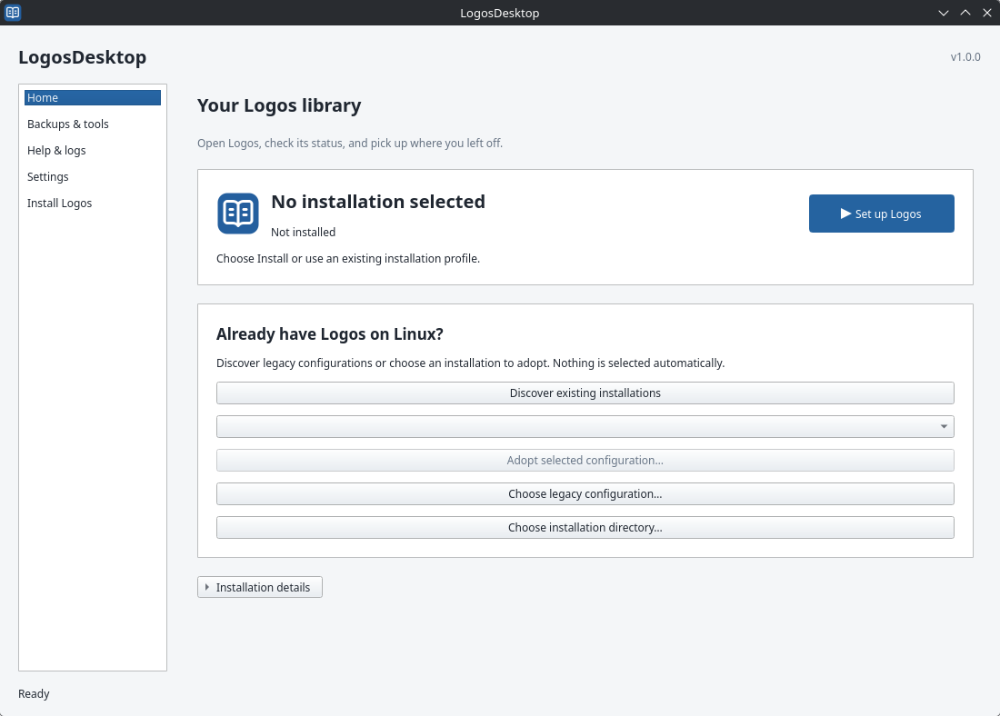

<p align="center">
  
</p>

<h1 align="center">LogosDesktop</h1>

<p align="center"><strong>Install and manage Logos on Linux, from one desktop app.</strong></p>

<p align="center">
  <a href="docs/INSTALL.md"></a>
  <a href="LICENSE"></a>
</p>

<p align="center">
  <strong><a href="#install">Install</a></strong> ·
  <a href="docs/README.md">User guide</a> ·
  <a href="CONTRIBUTING.md">Contribute</a>
</p>

LogosDesktop brings setup, updates, backups and everyday maintenance into a Qt
interface. It runs Logos through Wine and keeps your controller and library separate.
This is an independent community project, not affiliated with or endorsed by Logos.

## Install

Copy this into your terminal to install the latest stable release:

```bash
curl -fsSL https://github.com/sdwoodard/logos-desktop/releases/latest/download/install.sh | bash
```

Then run:

```bash
logos-desktop
```

Or search for **LogosDesktop** in your application menu. If the installer adds the
command to PATH, open a new terminal first.

**Requirements:** Linux x86_64, Bash, curl and standard archive/checksum tools.
The installer reuses a suitable Python or downloads a private, checksum-verified
Python runtime automatically. Qt/PySide6 is installed automatically too.
It uses your account and leaves system Python unchanged.
It downloads code from this project's release channel and configures updates and
launchers. The command requires a published release.

**[Download first](docs/INSTALL.md#download-first)** ·
**[Install from source](CONTRIBUTING.md#source-setup)** ·
**[Requirements and options](docs/INSTALL.md)**

Choose **Set up Logos** on Home. Your Logos account and content licenses are still required.

<picture>
  <source media="(prefers-color-scheme: dark)" srcset="docs/media/home-dark.png">
  
</picture>

## Start with your library

Follow the [installation guide](docs/INSTALL.md), then choose **Set up Logos** on
Home. The app suggests a location you can change before installing. Your Logos
account and content licenses are still required.

Release downloads and verified commands appear on
[Releases](https://github.com/sdwoodard/logos-desktop/releases).
Check [requirements and compatibility](docs/COMPATIBILITY.md) before choosing a
Wine runtime. Building from source? Start with [Contributing](CONTRIBUTING.md).

## Keep everyday tasks close

- **Home:** open or stop Logos and check updates for Logos and LogosDesktop.
- **Backups & tools:** protect your data, manage indexing and find repair tools.
- **Help & logs:** run diagnostics and preview a support report before sharing it.
- **Settings:** choose your appearance, backup folder and installation profile.

Controller updates use the installation's managed Python environment. Confirm the
update in the app, follow its progress and let LogosDesktop restart automatically.
Logos and Wine updates are separate. See [update guidance](docs/INSTALL.md#wheel-controller-updates)
and [backup and recovery](docs/BACKUPS.md).

## Support

Start with [troubleshooting](docs/SUPPORT.md) and the [known limitations](docs/COMPATIBILITY.md).
For a bug report, include the action, expected result and what happened instead.
Support reports are created locally. Review them before sharing, and keep account
links, passwords and private library content out of public issues.

## Help shape the project

Clear bug reports, useful documentation and focused fixes are welcome.
[Contributing](CONTRIBUTING.md) explains setup, checks and small first tasks.

[User guide](docs/README.md) · [Release notes](CHANGELOG.md)
